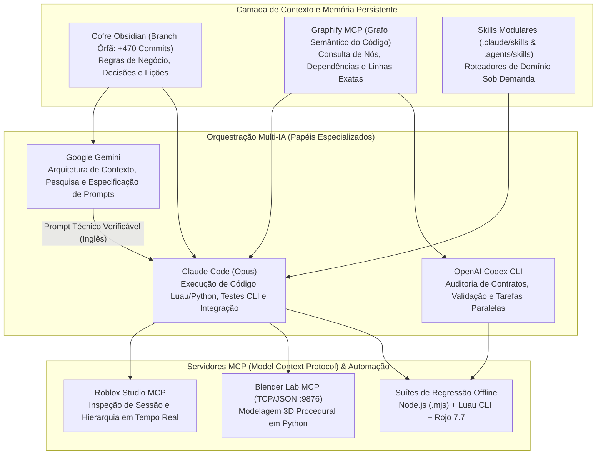
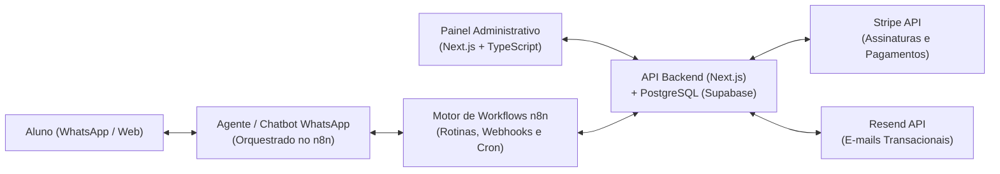

# Alexandre Colombari — AI Engineering & Software Architecture Portfolio

**Estudante de Engenharia da Computação (UNAERP)** | **Ribeirão Preto, SP**  
[LinkedIn](https://www.linkedin.com/in/alexandre-colombari/) • [E-mail](mailto:alexandrecolombari2007@gmail.com) • [GitHub](https://github.com/AleColombari)

> Este repositório documenta a arquitetura técnica, os fluxos agênticos de Inteligência Artificial, as automações de processos e os exemplos reais de **Engenharia de Prompts e de Contexto** que desenvolvi e opero em projetos privados em produção e em beta fechado (**Rogue Mining** e **Studio Life**).

---

## Sumário do Portfólio de IA

1. [Ecossistema Multi-Agente, MCP e Grafo de Conhecimento (Rogue Mining)](#1-ecossistema-multi-agente-mcp-e-grafo-de-conhecimento-rogue-mining)
2. [Engenharia de Prompts e de Contexto — Exemplos Reais Estruturados](#2-engenharia-de-prompts-e-de-contexto--exemplos-reais-estruturados)
3. [Ferramentas Internas com Python (Visão Computacional / IoU) e Governança Git](#3-ferramentas-internas-com-python-visão-computacional--iou-e-governança-git)
4. [Automação de Workflows, Dashboard e Chatbot com n8n (Studio Life)](#4-automação-de-workflows-dashboard-e-chatbot-com-n8n-studio-life)
5. [Stack Tecnológica](#5-stack-tecnológica)

---

## 1. Ecossistema Multi-Agente, MCP e Grafo de Conhecimento (`Rogue Mining`)

**Contexto do Projeto:** *Rogue Mining* é um jogo multiplayer roguelite em Beta Fechado na plataforma Roblox (repositório privado com **+620 commits autorais**, desenvolvido em equipe de **4 desenvolvedores**). Para escalar o desenvolvimento de sistemas distribuídos complexos (motor Voxel server-authoritative, persistência transacional multi-place, 9 mutações elementais e pipeline 3D procedural), estruturei uma arquitetura de **Engenharia de Software Assistida por Agentes de IA**.

### Arquitetura da Orquestração de Agentes e Memória Persistente



### Problemas Reais Resolvidos por essa Arquitetura:
- **Redução de Alucinação e Economia de Tokens com Obsidian + Graphify:** Em vez de injetar dezenas de milhares de linhas de código no contexto do LLM a cada sessão, os agentes consultam o grafo semântico (**Graphify MCP**) e um **Cofre de Conhecimento em Obsidian** (mantido em uma branch órfã `cofre-obsidian` com mais de **470 commits**). Cada sessão registra apenas as lições aprendidas e armadilhas descobertas no código.
- **Conexão Direta com Motores Gráficos via MCP:** Integração de 3 servidores **Model Context Protocol (MCP)** em escopo de usuário (`Roblox_Studio`, `Blender Lab MCP v1.0.3` na porta TCP 9876 e `Graphify`), permitindo que o agente inspecione a cena aberta, execute geradores Python no Blender e valide o resultado sem intervenção manual repetitiva.

---

## 2. Engenharia de Prompts e de Contexto — Exemplos Reais Estruturados

No meu fluxo de trabalho diário, separo a **fase de especificação e descoberta** (feita em português com leitura prévia dos arquivos e protocolo de interrogação de requisitos) da **fase de execução** (entregue em inglês estruturado para maximizar a precisão de raciocínio do modelo executor).

### Protocolo em 3 Etapas Antes de Qualquer Código:
1. **Inspeção Read-Only do Código e do Cofre:** Levantamento dos arquivos exatos, linhas, contratos de rede (`Remotes`) e suítes de teste existentes.
2. **Interrogação de Casos de Borda (Clarifying Questions):** Identificação de pontos cegos (como limites de validação server-side, clamps ocultos na UI ou impacto de performance em dispositivos móveis) antes de redigir a especificação.
3. **Redação do Prompt Executável com Critérios de Aceite Verificáveis:** O prompt especifica restrições de branch, arquivos exatos, invariantes de servidor e os testes CLI obrigatórios.

---

### Exemplo Real 1: Prompt de Especificação Full-Stack (Upgrade de Magnetismo & Miniaturas 3D de Drops)
*Caso real onde a inspeção prévia identificou duas armadilhas críticas no código antes da execução: um `math.clamp(..., 6, 40)` no cliente que travaria os níveis 3–5 do upgrade, e o `PickupRange = 48` fixo no servidor que rejeitaria coletas legítimas com erro `"far"`.*

```markdown
## Objective
Overhaul the Ore Drop & Collection system across 4 interconnected requirements:
1. Near-Instant Multi-Item Collection (`CollectGap = 0.004` s) & Larger Absorption Radius (`CollectRadius = 2.5` studs), decoupling particle `burst` throttling (`0.03` s) from item absorption so collecting 30+ fragments in a crater never drops mobile FPS.
2. Purchasable Individual Magnetism Range Upgrade in the Oficina (`ITENS` tab) — 5 levels, +1 block (+6 studs) per level (24 -> 54 studs), following the exact `BackpackUpgrade` architecture.
3. 1 Miniature Block per Drop scaling with stack count (`Copies = 1`).
4. True Miniature 3D Block Visual (Layer Substrate + `Gems` Mesh + Elemental Mutation VFX).

## Critical Edge Cases & Implementation Constraints
- **Server Validation (`src/server/OreDropService.luau`)**: Currently `OreDropService.Config.PickupRange = 48` studs (sized for base 24-stud magnet + scatter + lag). At `RunMagnetLevel = 5`, the client pulls drops from `54` studs away. Update `OreDropService:Collect(player, ids)` so the allowed server pickup range adds the player's magnet upgrade bonus (`Config.PickupRange + level * 6`), preventing false `"far"` rejections.
- **Client Clamp Bugfix (`ui-lab/src/shared/Screens/Drops.luau:447`)**: `SetMagnetRadius` currently clamps `math.clamp(tonumber(r) or 24, 6, 40)`, which would cap levels 3–5 at 40 studs instead of 54 studs. Raise the upper clamp to `90` studs.
- **Composite Template Scaling (`ReplicatedStorage.BlockVisualTemplates`)**: Resolve depth substrate via `OreSubstrateResolver.ResolveForY(baseName, by)` where `by = math.floor(origin.Y / 6)`. Scale both root and child `Gems` MeshPart by `sz / 6` and update `Gems.CFrame = cf * scaledGemsOffset` every Heartbeat step.

## Verification & Testing
1. Update and run `tests/OreDropServiceSelfTest.luau`, `tools/test-uiv2-oficina.mjs`, and `tools/test-uiv2-pickups.mjs`.
2. Build both `default.project.json` and `lobby.project.json` with `rojo build` to confirm 0 errors.
```

---

### Exemplo Real 2: Prompt de Rebalanceamento Geológico e Sincronização de Testes Determinísticos
*Exemplo de prompt voltado para alteração de regras matemáticas e paridade entre múltiplos testes automatizados (`.luau` e `.mjs`).*

```markdown
## Objective
Reduce the geological layer depth boundaries (`maxDepth` in blocks, where 1 block = 6 studs) across both Mine 1 and Mine 2 so players can realistically progress through all 5 layers within the 180-second run day:
- Layer 1 & Layer 6: `maxDepth = 26` (`-156` studs)
- Layer 2 & Layer 7: `maxDepth = 70` (`-420` studs)
- Layer 3 & Layer 8: `maxDepth = 130` (`-780` studs)
- Layer 4 & Layer 9: `maxDepth = 210` (`-1260` studs)
- Layer 5 & Layer 10: `maxDepth = math.huge` (`Y <= -211` blocks)

## Required Synchronizations Across the Codebase
1. `src/shared/GameConfig.lua`: Update `maxDepth` for Layers 1..4 and 6..9; update `GeoLayer` boundary comments.
2. `src/shared/MineSpawnCave.luau`: Update `DefaultFloorBlockYForLayer` (`{ 0, -27, -71, -131, -211 }`) so layer-shift upgrades spawn players at the exact top of each new layer.
3. Automated Regression Suites: Update hardcoded boundary assertions in `tests/GeologicalLayersSelfTest.luau`, `tools/test-voxel-open-world.mjs`, and `tools/test-bonanza-generation.mjs`.
```

---

## 3. Ferramentas Internas com Python (Visão Computacional / IoU) e Governança Git

Para resolver gargalos reais de produção em equipe, construímos ferramentas internas que automatizam validações que antes exigiam revisão manual demorada:

### 3.1. Pipeline de Medição Computacional de Referências 2D/3D em Python (`NumPy` + `Pillow` + `Blender API`)
Quando um agente de IA modela um asset 3D no Blender via Python, avaliações subjetivas ("está largo demais", "está baixo") geram retrabalho e alto gasto de tokens. Para resolver isso:
- **Extração de Medidas da Folha de Referência (`medir_folha.py`):** Script em Python utilizando `NumPy` e `Pillow` que segmenta as vistas ortogonais (frente, perfil, costas, topo) via *flood fill* a partir das bordas, calcula a caixa delimitadora (*bounding box*), extrai a largura relativa a cada faixa de 10% da altura (`medidas.json`) e identifica a paleta dominante por *k-means*.
- **Validação por IoU (*Intersection over Union*):** A cada checkpoint de modelagem no Blender (`cp1` a `cp3`), o gerador Python renderiza as vistas ortogonais do modelo 3D e calcula o índice **IoU** contra a máscara da referência 2D (exigindo meta objetiva `IoU >= 0.70` na blocagem e `IoU >= 0.80` no modelo final antes da aprovação).

### 3.2. Governança Git em Equipe (4 Desenvolvedores) e Auditoria de Merge (`Node.js`)
- Trabalho colaborativo dividido em branches por desenvolvedor e área de domínio (`alexandre`, `alex`, `popas`, `bruno`), protegendo a branch `main` contra commits diretos de agentes de IA.
- Utilização de scripts de auditoria em Node.js (`merge-audit.mjs`) e suítes de testes em CLI (`tools/test-*.mjs` executando o binário do `luau` em processos filhos isolados) para integrar 8 branches paralelas sem regressões e sem perda de código.

---

## 4. Automação de Workflows, Dashboard e Chatbot com n8n (`Studio Life`)

**Contexto do Projeto:** Sistema web full-stack e plataforma de automação criada para centralizar a operação e o atendimento de um estúdio de yoga.



### Entregas e Resultados Práticos:
- **Economia Real de Horas Operacionais:** Automação completa do agendamento de aulas, controle de listas de espera, lembretes automáticos em segundo plano via **n8n** e atendimento automatizado de alunos via **Chatbot integrado ao WhatsApp**.
- **Dashboard e Arquitetura Full-Stack:** Painel administrativo desenvolvido em **Next.js (React)** e **TypeScript**, banco de dados relacional modelado em **PostgreSQL (Supabase)**, pagamentos recorrentes integrados via **Stripe** e disparo de recibos/confirmações via **Resend**.

---

## 5. Stack Tecnológica

- **IA & Engenharia Agêntica:** Claude Code, OpenAI Codex CLI, Google Gemini API, Engenharia de Prompts e de Contexto, MCP (Model Context Protocol), Graphify (Knowledge Graphs), Obsidian, n8n.
- **Linguagens & Frameworks:** Python (`NumPy`, `Pillow`, `bpy` / Blender API), TypeScript, JavaScript (Node.js), Luau, C/C++, SQL, Next.js (React), HTML/CSS.
- **Infraestrutura, Dados & Ferramentas:** Git/GitHub, Rojo, Docker, PostgreSQL (Supabase), Stripe API, Resend API, Testes Automatizados via CLI.
